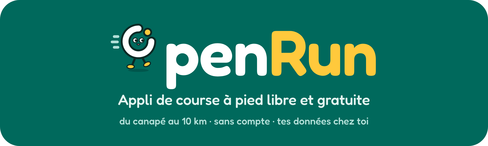
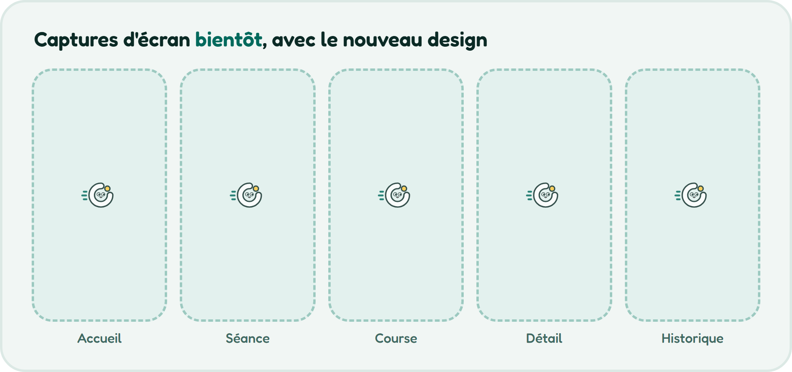

<p align="center">
  
</p>

<h3 align="center">Une appli de course à pied que tu possèdes vraiment.</h3>

<p align="center">
  Des programmes guidés du canapé aux 5 puis 10 km, à ton rythme, depuis le point de départ que tu choisis.<br>
  Sans compte, sans publicité, sans paywall: tes séances restent sur ton téléphone.
</p>

<p align="center">
  <a href="https://github.com/Marrmud/openRun/releases/latest"></a>
  <a href="https://github.com/Marrmud/openRun/releases"></a>
  <a href="https://github.com/Marrmud/openRun/actions/workflows/test.yml"></a>
  
  <a href="LICENSE"></a>
</p>

<p align="center">
  <a href="https://github.com/Marrmud/openRun/releases/latest"><b>Télécharger l'APK</b></a> ·
  <a href="docs/INSTALL.md">Guide d'installation</a> ·
  <a href="#roadmap">Roadmap</a> ·
  <a href="CHANGELOG.md">Changelog</a> ·
  <a href="PRIVACY.md">Vie privée</a>
</p>

---

## Pourquoi

Les applis de course gratuites sont limitées, les bonnes sont derrière un abonnement, et presque toutes veulent un compte.
openRun part d'un constat simple: **courir ne devrait pas demander d'abonnement ni d'inscription.** Une appli claire pour
débuter, qui reste utile quand on progresse, et dont le code est ouvert pour que chacun puisse vérifier ce qu'elle fait.

## Ce qu'elle fait

### Courir sans se poser de questions
- **Programmes guidés**: Pré-C25K, Du canapé au 5 km, Pont vers 10K, Du canapé au 10 km, avec un conseil par semaine.
- **Point de départ libre**: une question (« Où en es-tu ? ») et c'est parti. Aucune semaine verrouillée, et sauter à une
  séance valide celles d'avant, après confirmation.
- **Course libre** avec distance, allure et tracé GPS.

### Un écran de course pensé pour courir
- **Trois styles au choix, changeables en pleine séance**: *Focus* (un énorme compte à rebours), *Chronologie* (toute la
  séance d'un coup d'œil) et *Complet* (toutes les métriques).
- **Intervalle précédent / suivant**, recommencer l'intervalle, revenir à l'échauffement, pause, verrouillage de l'écran
  par appui long, terminer en avance (enregistrer ou supprimer).
- **Continue écran verrouillé**, téléphone en poche.

### Du son qui ne dérange pas ta musique
- **Voix, bips et vibrations**, chacun avec son interrupteur.
- **Avec ta musique ou ta vidéo**: *Superposer* (jamais touchée), *Baisser* ou *Pause*. Tout couper ne demande aucune
  priorité audio: ta vidéo ne se met pas en pause « pour rien ».

### Une progression agréable
- **Rangs de Fer à Diamant**, qui montent avec les calories dépensées, et un **objectif par semaine**: un jour de repos ne
  casse rien.
- **Historique** par date ou par programme, et **détail de chaque séance**: tracé, allure, tours, données de montre
  quand il y en a.

### Tes données t'appartiennent
- **Sans compte, sans serveur, sans pistage.** Voir [PRIVACY.md](PRIVACY.md).
- **Health Connect** (optionnel): chaque séance peut s'écrire dans Health Connect, que Google Health lit. Écriture
  seule: openRun ne lit rien.
- **Reprise après plantage**: si Android arrête l'appli en pleine course, la séance t'est proposée à l'ouverture suivante.

## Captures d'écran

<p align="center">
  
</p>

## Installer

1. Télécharge `openRun-<version>.apk` depuis la [dernière version](https://github.com/Marrmud/openRun/releases/latest).
2. Ouvre-le et autorise l'installation une fois.
3. Lance openRun, réponds à « Où en es-tu ? » et appuie sur Démarrer.

Détails, vérification de l'empreinte et mises à jour dans le [guide d'installation](docs/INSTALL.md). Pas de Play Store pour
l'instant.

## Roadmap

<table>
<tr><td width="150"><b>✅ Disponible (0.1.0)</b></td><td>Programmes guidés, course libre, écran de course (3 styles), voix / bips / vibrations, modes musique, rangs, objectif hebdomadaire, historique et détail, Health Connect, reprise après plantage.</td></tr>
<tr><td><b>🚧 En cours</b></td><td>Éprouver le GPS et la voix sur des sorties réelles. Nouveau logo et habillage de l'appli (mascotte).</td></tr>
<tr><td><b>⏭️ Prochainement</b></td><td><b>Appli Wear OS</b> (enregistrement autonome avec GPS et cardio, séance guidée au poignet, synchro avec le téléphone) · thème sombre et couleurs dynamiques · anglais.</td></tr>
<tr><td><b>🗓️ Ensuite</b></td><td>Calendrier et plusieurs séances par jour · constructeur de séances et plans par objectif (10 km en 55 min…) · plan adaptatif · zones de fréquence cardiaque et d'allure, VO2max estimée · badges · export GPX · guide / FAQ.</td></tr>
<tr><td><b>🔭 Plus tard</b></td><td>Carte du tracé · charge d'entraînement · suivi des chaussures · F-Droid · iOS et Apple Watch.</td></tr>
</table>

Le détail, avec les décisions et leurs raisons, est dans la [bible du projet](docs/BIBLE.md) et dans [docs/ROADMAP.md](docs/ROADMAP.md).

## Sous le capot

- **`core/`**: du Kotlin pur, sans Android. Tout ce qui *décide* (programmes, progression, calories, rangs, moteur de
  séance, règles audio, règles d'écriture vers Health Connect) y vit, avec ses tests (100 aujourd'hui).
- **`app/`**: l'appli (Jetpack Compose, Material 3, Room, DataStore, Health Connect). Aucun service Google Play requis
  pour courir: le GPS est celui d'Android.
- Dépendances volontairement peu nombreuses, aucune bibliothèque de pistage ou de publicité.

## Construire soi-même

Windows ou Linux, JDK 21, Android SDK (chemin dans `local.properties`).

```bash
./gradlew :core:test                      # la logique (programmes, progression, calories, rangs, moteur)
./gradlew :app:assembleDebug              # l'appli de debug (s'installe à côté de la vraie: org.openrun.app.debug)
./gradlew :app:connectedDebugAndroidTest  # stockage et réglages, sur un téléphone branché
./gradlew :app:assembleRelease            # l'APK de diffusion, signé si une clé est configurée
```

<details>
<summary>Notes de terrain</summary>

- Si Gradle échoue avec « Unable to establish loopback connection »: `JAVA_TOOL_OPTIONS=-Djdk.net.unixdomain.tmpdir=C:\gradle-home\uds` (dossier à créer).
- Tests sur téléphone en adb Wi-Fi: donner à `ANDROID_SERIAL` le nom mDNS (`adb devices`, ligne `adb-…_adb-tls-connect._tcp`), pas `IP:port`.
- Signature de la release: variables `OPENRUN_KEYSTORE_FILE`, `OPENRUN_KEYSTORE_PASSWORD`, `OPENRUN_KEY_ALIAS`, `OPENRUN_KEY_PASSWORD`, ou un `keystore.properties` à la racine (ignoré par git). **Sans la clé, plus de mise à jour possible pour ceux qui ont installé l'appli: garde-la à l'abri.**
- Debug seulement: `adb shell am broadcast -n org.openrun.app.debug/org.openrun.app.debug.DemoSeedReceiver` ajoute trois séances de démonstration; `adb shell pm clear org.openrun.app.debug` efface tout.
- `spike/` est le banc d'essai jetable qui a validé le GPS et l'audio ([docs/T0-SPIKE.md](docs/T0-SPIKE.md)).

</details>

## Contribuer

Les retours d'une vraie sortie valent de l'or: ouvre une [issue](https://github.com/Marrmud/openRun/issues) avec ton
téléphone, ta version d'Android et ce qui s'est passé. Pour proposer du code, lis [CONTRIBUTING.md](CONTRIBUTING.md).

## Documentation

| | |
|---|---|
| [docs/BIBLE.md](docs/BIBLE.md) | Vision, décisions (avec leur raison), risques, journal |
| [docs/MVP.md](docs/MVP.md) | Périmètre du MVP et tranches de construction |
| [docs/FEATURES.md](docs/FEATURES.md) | Toutes les idées de fonctionnalités, par palier |
| [docs/DESIGN.md](docs/DESIGN.md) | Principes de design et contraintes |
| [design/](design) | Logo, mascotte et planche de marque (sources du design) |
| [mockups/](mockups/index.html) | Maquettes HTML (téléphone et montre) |

## Licence

[GPL-3.0 ou plus](LICENSE). Logiciel libre: tu peux l'utiliser, l'étudier, le modifier et le partager, à condition que
les versions modifiées restent libres.
